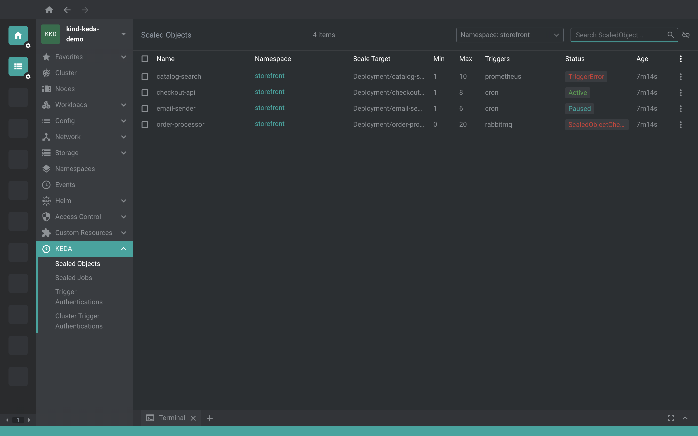
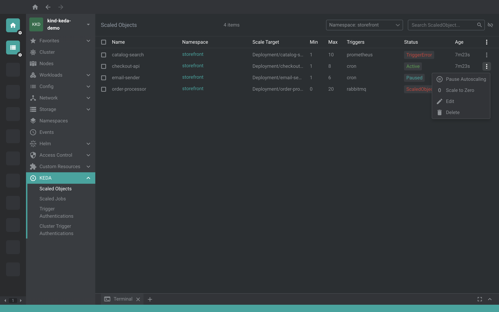
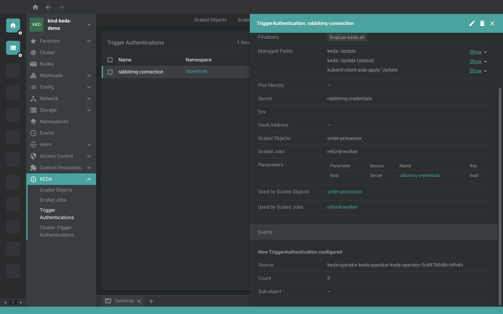

# @freelensapp/keda-extension

<!-- markdownlint-disable MD013 -->

[](https://freelens.app)
[](https://github.com/freelensapp/freelens-keda-extension)
[](https://github.com/freelensapp/freelens-keda-extension/releases)
[](https://github.com/freelensapp/freelens-keda-extension/actions/workflows/integration-tests.yaml)
[](https://www.npmjs.com/package/@freelensapp/keda-extension)

<!-- markdownlint-enable MD013 -->

## Overview

[Freelens](https://freelens.app) extension for [KEDA](https://keda.sh), the
Kubernetes Event-driven Autoscaling, which scales a workload on the events and
the metrics of the systems it reads from, down to zero and back up.

The extension lives in the cluster sidebar under **KEDA**: **Scaled Objects**,
**Scaled Jobs**, **Trigger Authentications** and **Cluster Trigger
Authentications**, with the columns of `kubectl get`. Each kind has a details
panel with its triggers, its authentication parameters and its scaling events,
and the menu of a ScaledObject or a ScaledJob pauses, scales to zero or resumes
its autoscaling.







## Authors

- [Nídio Dolfini](https://github.com/nidiodolfini) created this extension,
  ported it to the extension API of Freelens 2, and maintains it.
- [Roberto Bandini](https://github.com/robertobandini) reviewed it and brought
  it into the organization, with its integration tests.

## Requirements

- Freelens 2.0.0 or a later 2.x (extension API v2). Freelens 1.x needs a 1.x
  version of the extension, `freelens-keda-extension` 1.0.3, which is no
  longer maintained.
- KEDA 2.x, which serves `keda.sh/v1alpha1`. The extension follows KEDA 2.21.

## Supported APIs

| Group     | API Version | Kind                           | Shown in                        |
| --------- | ----------- | ------------------------------ | ------------------------------- |
| `keda.sh` | v1alpha1    | `ScaledObject`                 | Scaled Objects                  |
| `keda.sh` | v1alpha1    | `ScaledJob`                    | Scaled Jobs                     |
| `keda.sh` | v1alpha1    | `TriggerAuthentication`        | Trigger Authentications         |
| `keda.sh` | v1alpha1    | `ClusterTriggerAuthentication` | Cluster Trigger Authentications |

When the cluster does not serve a kind, its page says so. While the extension
is enabled, the four kinds are left out of the Custom Resources tree of the
cluster sidebar, so each of them is listed once, under KEDA.

## Permissions

The pages list and watch the four kinds, and the details panels read the
events of an object from the events Freelens already loads. The menu items of
a ScaledObject or a ScaledJob patch its annotations, so they need `patch` on
`scaledobjects` or `scaledjobs` in its namespace; without it, Freelens shows
the error of the patch. Nothing else writes to the cluster.

## Install

Open Freelens and go to Extensions (`ctrl`+`shift`+`E` or
`cmd`+`shift`+`E`). The field at the top takes a package name, the URL of a
tarball, or the path to a tarball or a directory.

### From the registry

Enter `@freelensapp/keda-extension` and press Install.

Alternatively, open the following URL in the browser to install directly:

[freelens://app/extensions/install/%40freelensapp%2Fkeda-extension](freelens://app/extensions/install/%40freelensapp%2Fkeda-extension)

### From a release tarball

Each [release](https://github.com/freelensapp/freelens-keda-extension/releases)
has the extension as `freelensapp-keda-extension-<version>.tgz`, with its
checksum in `freelensapp-keda-extension-<version>.tgz.sha256`. Use a release
whose major version matches your Freelens version.

- Enter the URL of the `.tgz` asset and press Install. Freelens downloads the
  `.tgz.sha256` next to it and checks the tarball against it.
- Or download both files into one directory and enter the path to the `.tgz`,
  or drop the `.tgz` on the Freelens window. Freelens checks it against the
  `.tgz.sha256` next to it.

### From a directory

Build the extension (see below), then enter the path to your checkout, the
directory with `package.json`, and press Install. Freelens runs the extension
from that directory, from the files in `dist/`, and lists it as unverified.
This is how you work on the extension: see
[Development loop](#development-loop).

## Getting started

The objects in `examples/keda/` show every view on a cluster with KEDA
installed:

```sh
kubectl apply -f examples/keda/deployments.yaml
kubectl apply -f examples/keda/triggerauthentication.yaml
kubectl apply -f examples/keda/clustertriggerauthentication.yaml
kubectl apply -f examples/keda/scaledobject-cpu.yaml
kubectl apply -f examples/keda/scaledobject-cron.yaml
kubectl apply -f examples/keda/scaledjob.yaml
```

| File                                | Objects                                                                                                                                                      |
| ----------------------------------- | ------------------------------------------------------------------------------------------------------------------------------------------------------------ |
| `deployments.yaml`                  | the Deployments `example-app` and `example-cron`, of the pause image; KEDA accepts one ScaledObject per workload, so each ScaledObject scales one of its own |
| `triggerauthentication.yaml`        | the Secret `example-credentials` and the TriggerAuthentication `example-auth`, which passes its `token`                                                      |
| `clustertriggerauthentication.yaml` | the ClusterTriggerAuthentication `example-cluster-auth`, which passes the variable `TZ` of the scale target's container                                      |
| `scaledobject-cpu.yaml`             | `example-app-cpu`, which keeps `example-app` between 1 and 5 replicas following CPU utilization at 50% (the HPA reads the CPU from metrics-server)           |
| `scaledobject-cron.yaml`            | `example-cron`, which wakes one replica of `example-cron` between 00:30 and 00:45 (America/Sao_Paulo), with `example-cluster-auth`                           |
| `scaledjob.yaml`                    | `example-job`, which runs one Job at a time in the first ten minutes of every hour, with `example-auth`                                                      |

The cron scaler takes no credentials: the authentication refs of the cron
triggers are there for the links between the objects, and resolve without any
outside system.

Open the cluster in Freelens. The KEDA pages list the objects; the details of a
ScaledObject or a ScaledJob show its triggers, and its scaling events fill in
as the controller reconciles it. The details of `example-auth` link to its
Secret and to `example-job`. Then open the menu of a ScaledObject and choose
**Pause Autoscaling** or **Scale to Zero**: the Status column turns to `Paused`
once the controller applies the annotation, and **Resume Autoscaling** brings
the autoscaling back.

## Features

### Lists

- **Scaled Objects** (`so`): Name, Namespace, Scale Target, Min, Max, Triggers,
  Status, Ready, Active, Fallback and Age, the columns of `kubectl get so`. The
  scale target reads `kind/name`, such as `Deployment/example-app`, before and
  after the controller has resolved it.
- **Scaled Jobs** (`sj`): Name, Namespace, Min, Max, Triggers, Status, Ready,
  Active and Age, from `kubectl get sj`.
- **Trigger Authentications** (`ta`): Name, Namespace, Pod Identity, Secret,
  Env, Vault Address, the Scaled Objects and Scaled Jobs that use it, and Age,
  from `kubectl get ta -o wide`.
- **Cluster Trigger Authentications** (`cta`): the same without Namespace, with
  the File Path, from `kubectl get cta -o wide`.

Status sums up the conditions of a ScaledObject or a ScaledJob in one badge,
with the reason of the controller (`ScaledObjectReady`,
`ScaledObjectCheckFailed`, `Paused`, `Fallback`, `Active` and so on). Every list
has a column menu, which hides and shows columns and keeps the choice per list.
So that a list fits a narrow window, some columns start hidden: Ready, Active
and Fallback, which Status sums up, and the objects that use an
authentication, which `kubectl get` shows with `-o wide` only.

### Details

Each kind has a details panel in the drawer, next to what Freelens shows for
any custom resource: the printer columns of its CRD, its conditions and its
events.

- **ScaledObject**: links to the workload it scales and to the
  HorizontalPodAutoscaler the controller created for it, the polling interval,
  the cooldown period, the idle replica count, the initial cooldown period, the
  `advanced` options (restore to original, scaling modifiers), the fallback and
  the health of each metric it counts, the external metric names, the original
  replica count and the last active time.
- **ScaledJob**: the containers and the limits of the Jobs it creates, the
  polling interval, the history limits, the rollout and scaling strategies, the
  external metric names and the last active time.
- **Triggers**, for both: one section per scaler, with its type and its name
  over a table of its metric type, its metadata and a link to its
  TriggerAuthentication or ClusterTriggerAuthentication.
- **Scaling Events**, for both: the events the cluster records for the object,
  one per scaling decision of KEDA, newest first, up to 20, with their type,
  reason, message, count and last time. They read both event APIs: KEDA 2.20
  and older record events through `core/v1`, KEDA 2.21 through
  `events.k8s.io/v1`.
- **TriggerAuthentication** and **ClusterTriggerAuthentication**: every
  parameter the scalers get, with where its value comes from (a Secret, a
  ConfigMap, an environment variable, HashiCorp Vault, Azure Key Vault, GCP
  Secret Manager, AWS Secrets Manager or a service account token), the settings
  of pod identity, Vault, the cloud secret managers, OAuth2 and Azure service
  principals, and, for a TriggerAuthentication, links to the Secrets,
  ConfigMaps and service accounts it names and to the ScaledObjects and
  ScaledJobs that use it.

### Write actions

The menus of a ScaledObject and a ScaledJob write the annotations the
controller reads, the same as `kubectl annotate`:

- **Pause Autoscaling** sets `autoscaling.keda.sh/paused` to `true`, which
  keeps the target of a ScaledObject at its current replicas (KEDA 2.12 or
  later) and stops a ScaledJob from creating Jobs.
- **Scale to Zero**, for a ScaledObject, sets
  `autoscaling.keda.sh/paused-replicas` to `0`, which scales the target down to
  zero replicas and keeps it there. It asks first.
- **Resume Autoscaling** removes both annotations, and the controller scales
  the target again. It is the only item while the object is paused.

## Limits

- **`keda.sh/v1alpha1` only.** It is the only version of KEDA 2.x. The
  CloudEventSource and ClusterCloudEventSource of `eventing.keda.sh` have no
  page yet.
- **No forms.** The extension creates no object and edits no field besides the
  pause annotations; the editor of Freelens, or `kubectl`, does the rest.
- **Names only for a ClusterTriggerAuthentication.** Its Secrets and ConfigMaps
  are in the namespace of the KEDA operator, which the object does not say, so
  its panel shows their names without a link.

## Build from the source

### Prerequisites

Use [NVM](https://github.com/nvm-sh/nvm),
[mise-en-place](https://mise.jdx.dev/), or
[windows-nvm](https://github.com/coreybutler/nvm-windows) to install the
Node.js version in `.nvmrc`.

From the root of this repository:

```sh
nvm install
# or
mise install
# or
winget install CoreyButler.NVMforWindows
nvm install "$(cat .nvmrc)"
nvm use "$(cat .nvmrc)"
```

Install pnpm:

```sh
corepack install
# or
curl -fsSL https://get.pnpm.io/install.sh | sh -
# or
winget install pnpm.pnpm
```

### Build extension

```sh
pnpm install
pnpm build
```

The extension is built into `dist/`. To pack it into a tarball:

```sh
pnpm pack
```

One script to bump the prerelease version, build and pack the extension for
testing:

```sh
pnpm pack:dev
```

The tarball is placed in the current directory. Install it as described in
[From a release tarball](#from-a-release-tarball).

### Development loop

Install the extension from your checkout once, as described in
[From a directory](#from-a-directory), then run:

```sh
pnpm dev
```

It rebuilds the extension whenever a source file changes, and Freelens
reloads the extension after each rebuild, without a restart and without
packing. Stop it with `ctrl`+`C`.

Neither `pnpm build` nor `pnpm dev` type-checks; run `pnpm type:check` for
that. A change to `main` or `renderer` in `package.json` needs Freelens
restarted once.

To check the extension in Freelens with an AI agent, see "Checking the
Extension in Freelens Dev" in [AGENTS.md](AGENTS.md).

### Check the code

```sh
pnpm type:check
pnpm test:unit
pnpm lint:check
pnpm knip:check
```

and, for the formats that Biome does not cover:

```sh
pnpm trunk:check
```

### Integration tests

The integration tests drive Freelens dev, started from a
[freelensapp/freelens](https://github.com/freelensapp/freelens) checkout,
against a [kind](https://kind.sigs.k8s.io/) cluster. In the Freelens checkout:

```sh
pnpm dev
```

Freelens dev lists no cluster until a kubeconfig is added in Preferences >
Kubernetes > Kubeconfig Syncs. Add one with the kind cluster, for example:

```sh
kubectl config view --minify --flatten --context kind-kind > ~/kind-kind.kubeconfig
```

Then, with the kind cluster running, in the extension repository:

```sh
pnpm build
pnpm test:integration
```

The tests install the checkout in place, replacing any other installation of
the extension in Freelens dev. They apply the CRDs of the four kinds from the
sources of a KEDA release, without the controller, and delete them at the end,
and with them every KEDA object on the cluster, so use a kind cluster with
nothing worth keeping. Without Freelens dev or the cluster the tests are
skipped.

Optional variables:

- `TEST_KIND_CLUSTER_NAME`: the kind cluster, `kind` by default, used
  through the context `kind-<name>`.
- `TEST_KEDA_VERSION`: the KEDA release of the CRDs, `v2.21.0` by default.
- `FREELENS_CDP_URL`: the CDP endpoint of Freelens dev,
  `http://127.0.0.1:9223` by default.
- `FREELENS_MAIN_LOG`: a log of the main process to check for errors, such
  as its `lens.log`. Without it only the renderer's errors are checked.

## License

Copyright (c) 2025-2026 Freelens Authors.

[MIT License](https://opensource.org/licenses/MIT)

The sidebar icon is drawn from the KEDA logo (Apache-2.0): its Kubernetes-style
heptagon and the lightning bolt of its lettering, as filled shapes in the color
of the Freelens theme.
